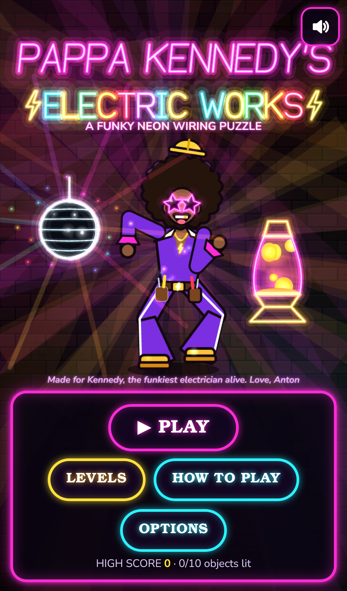

# Pappa Kennedy's Electric Works ⚡🕺

A funky neon wiring puzzle made for **Kennedy, the funkiest electrician alive** (love, Anton).

### ▶ Play: https://antonolson47-ctrl.github.io/pappa-kennedys-electric-works/

Works in iPhone Safari (Share → *Add to Home Screen* for full-screen play), Android Chrome (*Install app* / *Add to Home screen*) and desktop browsers. Portrait or landscape, rotate whenever you like. It's one self-contained HTML file: all the art is drawn in code and all music and sound are synthesized live with WebAudio, so it plays offline once loaded.

## How to play
Wire pieces fall into the panel. Fill a whole row from wall to wall to complete a run of wiring: the wire to the job glows further and the VOLTS meter climbs. Hit the row target and the breaker clunks on, the connection is made, and the job lights up in a big neon celebration. Then it's on to the next job, a little faster. Wire all **10 jobs**, ending with the **Christmas tree**, to become a certified Funk Electrician. Let the stack reach the top and *you got shocked, baby!*

Pappa Kennedy, your star-shaded foreman, dances, grunts and heckles you the whole way.

| # | Job to light | Rows |
|---|---|---|
| 1 | PAPPA'S OPEN sign | 6 |
| 2 | Groovy lava lamp | 8 |
| 3 | Disco ball | 10 |
| 4 | Neon "FUNK" sign | 10 |
| 5 | Funky jukebox | 12 |
| 6 | Roller-rink skate sign | 12 |
| 7 | Glowing afro-pick "FRO-TASTIC" sign | 14 |
| 8 | 70s Groove Van with neon trim | 14 |
| 9 | FUNK EXPRESS marquee | 16 |
| 10 | The Christmas tree | 18 |

Scoring: 1/2/3/4 rows = 100/300/500/800 × level (a 4-row clear is a FULL CIRCUIT), back-to-back 4-row clears ×1.5, combo bonus for clearing on consecutive pieces, a level bonus when a job lights, and a big SPOTLESS PANEL bonus for clearing the whole board. High score, unlocked levels and lit jobs are saved on the device.

## Controls
**Touch:** big buttons under the panel in portrait and on both sides in landscape: ◀ ▶ move, SOFT drop, DROP (hard drop), HOLD, ↺ / ↻ rotate. Gestures on the panel (toggle in Options): tap = rotate, drag = move / soft drop, flick down = hard drop, flick up = hold. Pause and mute buttons at the top.

**Keyboard:** ← → (or A/D) move · ↓ (or S) soft drop · Space hard drop · ↑ / X / W / E rotate clockwise · Z / Q / Ctrl rotate counter-clockwise · C / Shift hold · P / Esc pause · M mute · Enter / arrows in menus.

Options: music and SFX volume, mute, next track, ghost piece, screen shake, gestures, reset save.

## Music
Eight original procedural funk/disco tracks (slap bass, chicken-scratch guitar, clav, horn stabs, strings, four-on-the-floor hats): *Pappa's Theme*, *Breaker Box Boogie*, *Disco Voltage*, *Hot Neutral Ground*, *Ampere Strut*, *Conduit Cruise*, *Three-Phase Shake*, *Funky Holiday Lights*. The six in-game tracks rotate every ~1.5–2 minutes and on each new level, and they get faster and busier with the level.

## Dev notes
- `src/` parts are concatenated by `build.sh` into `PappaKennedy.html`; `make_pages.sh` builds the Pages site (`index.html` + icons + manifest).
- Tests (Playwright): `cd test && npm i && npx playwright install chromium webkit`, then `node desktop.js` (Chromium, keyboard), `node mobile.js iphone` (WebKit iPhone 13 profile), `node mobile.js pixel` (Chromium Pixel 7), `URL=https://… node live.js`.
- Everything is original: the shapes, rules and names are generic falling-block mechanics, and the mascot, catchphrases and music were written for this game.
